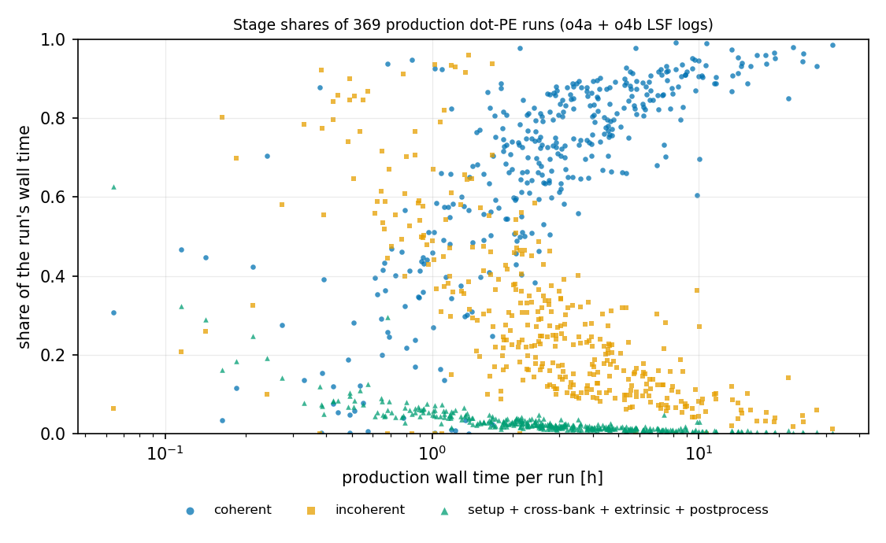

# Where production dot-PE spends its wall time, and why the earlier GPU attempt did not beat it

This measurement finds which stages of a production dot-PE run take the wall time, and so which
stages a GPU version must accelerate to halve it. It also explains why the earlier GPU attempt
gained no more than the multi-core CPU code. Finally, it sizes the scatter between repeat
production runs, which the acceptance test needs.

The results were made with dot-PE branch `gpu-v2` at 78df887; only scripts ran, no dot-PE code.
The data are:
1. the o4a-pe-paper and o4b-pe-paper production LSF logs (`artifacts/logs/dotpe_GW*/*.out`);
2. their rundirs `artifacts/pe/dotpe/<EVENT>/run_N/`. The dot-PE commit in each `timing.json`
   was reconstructed after the run from the clone's checkout history (306 of the 332 matched
   runs say so in their `note` field);
3. the branch `origin/dev/gpu` at 1847995.

Supersedes: none.

## Terms

- Bank: a set of intrinsic templates (2^20 in production), stored as amplitude and phase files of
  56 to 57 GiB per bank (`du`).
- n_int, n_ext and n_phi: the numbers of intrinsic templates, extrinsic samples, and orbital
  phases on the phase grid.
- The six stages of `mp_inference.run`:
  1. setup;
  2. incoherent selection: per-detector best fit of every template, summed over detectors;
  3. cross-bank threshold: keeps templates within 20 of the best incoherent sum over all banks;
  4. extrinsic proposal: cogwheel draws n_ext extrinsic samples;
  5. coherent stage: every kept template against every extrinsic sample and phase;
  6. postprocess: aggregation, distance draws, `samples.feather`.
- CPU-side stages: setup, cross-bank and extrinsic, the stages the GPU design leaves on the CPU.
- Lookup table: cogwheel's spline of the distance-marginalized likelihood, evaluated once per kept
  (template, extrinsic sample, phase) row.
- Linear-free time fit: the per-template weighted linear fit that sets each waveform's time
  shift before the likelihood.
- ln_evidence: the run's log evidence.
- n_effective_i and n_effective_e: the effective numbers of intrinsic and extrinsic samples,
  from `summary_results.json`.
- Median run: the log whose total wall time is closest to the median total of the 369 logs
  (GW250109_010541, 9944 s).
- 0.5× target: half a run's production wall time. The GPU budget is that target minus the
  CPU-side stages' production time.

## Question and answer

Where does the wall time of production runs go? The coherent stage takes a median share of 0.74
and the incoherent stage 0.23. The CPU-side stages take 0.015 (0.021 with postprocess).

Must the GPU cover more than the coherent and incoherent stages? No. At the median run the
CPU-side stages take 217 s of the 4972 s 0.5× target.

Why did the earlier GPU attempt not beat the CPU code?
1. It was benchmarked at settings (n_ext = 512, n_phi = 32) where the coherent stage was short.
2. At 2^20 templates its incoherent kernel sat idle about 94% of the time, waiting for disk reads
   and per-template CPU work.
3. It left the lookup table and the per-row numpy and pandas work on the CPU.

How much do repeat production runs differ? The repeat pairs share seeds and mostly differ in code
version, so they do not measure seed scatter. Their median Jensen–Shannon divergence of the 1-D
marginals is 0.012 to 0.018 bits, against an estimator floor of about 0.004 bits.

## Gate

The design's gate: a stage stays on the CPU only if the CPU-side stages take at most 50% of the
0.5× target for the median run. They take 217 s of 4972 s (4%), so setup, cross-bank and
extrinsic stay on the CPU.

## Setup

Stage times are the "Stage timings" block that `mp_inference.run` prints at the end of each LSF
log. 369 logs have it. 332 of them are matched to a rundir: the same event as the log, with
`timing.json` `wall_seconds` within 5 s of the log's total. The production runs used 8 cores with
7 workers, and all 332 matched runs had cProfile enabled (`profile_enabled: true`).

CPU-seconds by function come from `profile_output.prof`, which aggregates cProfile over the
workers. Cumulative times of nested functions overlap. The line "in-line numpy work in
`run_thin_iblock`" is that function's own time: array arithmetic and indexing written in its
body, not calls to separately profiled functions.

A repeat pair is two `status: ok` runs of one event with the same bank folders, n_int, n_ext and
n_phi. There are 16 such pairs (12 events). The Jensen–Shannon divergence is in bits, on 50 bins
spanning the 0.5 to 99.5 percentiles of the pair's union, with the `weights` column. Its estimator
floor is the divergence between two random halves of one run's samples, on the same bins.

## Results

### Which stage takes the wall time?

Figure 1 shows each run's share of wall time per stage against its total wall time. The coherent
share grows with wall time, from below 0.5 under 1 h to above 0.8 over 5 h. Runs under 1 h are
dominated by the incoherent stage.

Share of the wall time per stage, over the 369 runs:

| Stage | Median | 10th percentile | 90th percentile | Maximum |
|---|---|---|---|---|
| coherent | 0.742 | 0.306 | 0.918 | 0.992 |
| incoherent | 0.226 | 0.067 | 0.610 | 0.961 |
| extrinsic | 0.012 | 0.004 | 0.039 | 0.439 |
| postprocess | 0.005 | 0.002 | 0.012 | 0.263 |
| setup | 0.003 | 0.001 | 0.011 | 0.116 |
| cross-bank | 0.000 | 0.000 | 0.000 | 0.000 |

The total wall time has a median of 2.76 h, with a 10th to 90th percentile range of 0.78 to
8.88 h. The two common configurations are 3 banks with n_ext = 2048 (95 runs) and 6 banks with
n_ext = 2048 (81 runs). Their medians, in seconds:

| Configuration | Incoherent | Extrinsic | Coherent | Postprocess | Total |
|---|---|---|---|---|---|
| 3 banks, n_ext = 2048 | 1665 | 124 | 4672 | 35 | 6655 |
| 6 banks, n_ext = 2048 | 3282 | 135 | 6936 | 70 | 10944 |

The incoherent stage takes a median of 560 s per bank. Over the 332 matched runs, the log of the
coherent stage time correlates with the log of (kept templates × n_ext), with correlation
coefficient 0.93. The extrinsic stage's median per number of banks ranges from 72 to 206 s.

### What must the GPU stages achieve?

| Run | Production wall [s] | CPU-side [s] | GPU budget at 0.5× [s] | GPU budget at 0.1× [s] |
|---|---|---|---|---|
| median run (GW250109_010541, 6 banks) | 9944 | 217 | 4755 | 777 |
| GW240525_201644 run_2 (3 banks, n_ext = 13312) | 21022 | 191 | 10320 | 1911 |

The shortest runs set the harder bound. The 10 matched 1-bank runs with n_ext = 2048 have medians
of 714 s total, 112 s CPU-side and 261 s GPU budget. In that budget, the GPU must read one bank,
select from it, and run the coherent stage.

### What does the CPU spend its time on, inside each stage?

CPU-seconds by function, summed over the 7 workers (cumulative; nested lines overlap):

| | GW240525 run_2 (n_ext 13312) | GW240516 run_0 | GW240924 run_0 | GW241124 run_0 |
|---|---|---|---|---|
| coherent, total | 122,173 | 6,627 | 24,115 | 44,740 |
| ↳ <d\|h>, <h\|h> on the phase grid (matmul, einsum) | 57,392 | 1,025 | 3,321 | 6,233 |
| ↳ lookup table (scipy spline) | 13,231 | 2,476 | 9,773 | 18,126 |
| ↳ in-line numpy work in `run_thin_iblock` | 47,536 | 2,267 | 8,807 | 16,419 |
| incoherent, total | 13,402 | 11,076 | 11,266 | 16,005 |
| ↳ single-detector kernel | 8,950 | 6,606 | 7,676 | 11,917 |
| ↳ waveform reads | 3,135 | 3,689 | 2,767 | 3,225 |
| ↳ linear-free time fit (one `polyfit` per template) | 640 | 1,445 | 1,527 | 1,492 |

The last three columns are 3-bank runs with n_ext = 2048. At n_ext = 2048:
1. the lookup table takes 37 to 41% of the coherent CPU time;
2. the in-line numpy work takes 34 to 37%;
3. the matmul takes 14 to 15%.

At n_ext = 13312 the matmul takes 47%. A GPU coherent stage that moves only the matmul removes
14 to 47% of that stage's CPU time, depending on n_ext.

### Why did the earlier GPU attempt not beat the CPU code?

`origin/dev/gpu` (commits on `gpu/` from 2026-03-14 to 03-17) patched PyTorch kernels into
`dot_pe.inference`. The kernels covered:
1. the single-detector log-likelihood;
2. the per-mode <d|h> and <h|h> and the phase grid;
3. batched distance draws;
4. vectorized prior transforms;
5. some extrinsic matmuls.

Its benchmarks (`gpu/BENCHMARK.md`) used one L40S, an injection with signal-to-noise ratio about
11, n_ext = 512 and n_phi = 32. Wall times in seconds:

| Bank | serial CPU | GPU | speed-up |
|---|---|---|---|
| 2 × 2^16 templates | 436 | 245 | 1.8× |
| 2^20 templates | 1760 | 644 | 2.7× |

The comparison is with serial CPU, not with `mp_inference`. The `lsf-swarm` benchmarks measured
`mp_inference` on 8 workers against serial at other settings: 3.3× on a 2^18-template bank with
n_ext = 2048 (949 s against 3167 s), and 1.1× on a 2^12-template bank with n_ext = 512 (541 s
against 597 s). No benchmark compares the GPU code with `mp_inference` at matched settings, and
neither code was tested at production settings. Its own profiles (`gpu/PROGRESS.md`) give the
causes that limited it:
1. At n_ext = 512 and n_phi = 32, the coherent stage took 79 to 162 s. The stage that holds 74%
   of production time was hardly exercised.
2. At 2^20 templates, the incoherent kernel took 0.08 s per batch of 2048 templates. Waveform
   reads with the per-template time fit inside them took about 0.8 s per batch (425 s over 514
   calls of `load_amp_and_phase`), so the GPU was idle about 94% of the time. Host–device copies took about 1 s of 405 s, so they were not the cause.
   A bank preload into GPU memory (Track G) was written but off by default, and the benchmarks
   ran without it.
3. The lookup table, masks, threshold, DataFrames and top-k stayed in numpy and pandas.

### How much do repeat production runs differ?

| Measure, over 16 repeat pairs | Median | Its estimator floor |
|---|---|---|
| \|Δ ln_evidence\| | 0.56 | — |
| Jensen–Shannon divergence, chirp mass [bits] | 0.013 | 0.004 |
| same, ln q | 0.018 | 0.004 |
| same, chi_eff | 0.012 | 0.004 |
| same, luminosity distance | 0.013 | 0.004 |
| same, cos θ_JN | 0.017 | 0.004 |

15 of the 16 pairs share their seed (`run_kwargs` `seed`), so no pair measures the scatter from
seeds alone. The pairs differ in code version, seed pool or a bug fix:
1. GW240630_212937 run_2 against run_7 differ by 9.2e4 in ln_evidence, from the incoherent-bound
   fix; each has 1 sample;
2. GW241201_055758 and GW250109_010541 have n_effective_i ratios above 4000;
3. GW241127_061008 has 458 and 164 samples, so its estimator floor is 0.06 to 0.07 bits.

Seven pairs have |Δ ln_evidence| ≤ 0.5 and divergences ≤ 0.03 bits. The acceptance test needs
seed scatter, so its design measures it directly. Per-pair values are in
`artifacts/research/gpu-forensics/repeat_scatter.csv`.

## Observations after the experiment

1. The postprocess share has a median of 0.005 and a maximum of 0.26.
2. The extrinsic stage's median per number of banks lies between 72 and 206 s.

## Limitations

1. Every production stage time includes cProfile overhead (`profile_enabled` in all 332 matched
   runs). The baselines, including GW240525 run_2's coherent 18793 s, are therefore above what an
   unprofiled run takes.
2. The dot-PE commits of the production runs were reconstructed after the fact.
3. Many configuration cells hold 1 to 3 runs. Those cells are indicative only.
4. Profile CPU-seconds include contention among 7 workers on one node. They rank the kinds of
   work, but do not give single-core rates.
5. The repeat pairs mix code versions, so they bound run-to-run scatter from above.

## Reproduction

Each runs in the `dot-pe` env in under 15 s on the login node:
1. `python research/gpu-forensics/stage_times.py` gives the stage tables and the Amdahl budget,
   and writes `stage_times.csv`.
2. `python research/gpu-forensics/repeat_scatter.py` gives the repeat pairs, and writes
   `repeat_scatter.csv`.
3. `python research/gpu-forensics/profile_split.py` takes the rundirs
   `o4b-pe-paper/artifacts/pe/dotpe/GW240525_201644/run_2`, `GW240516_041939/run_0`,
   `GW240924_000316/run_0` and `GW241124_024914/run_0`.
4. `git show origin/dev/gpu:gpu/BENCHMARK.md` and `git show origin/dev/gpu:gpu/PROGRESS.md`.

Figure 1 is made from `stage_times.csv`.
