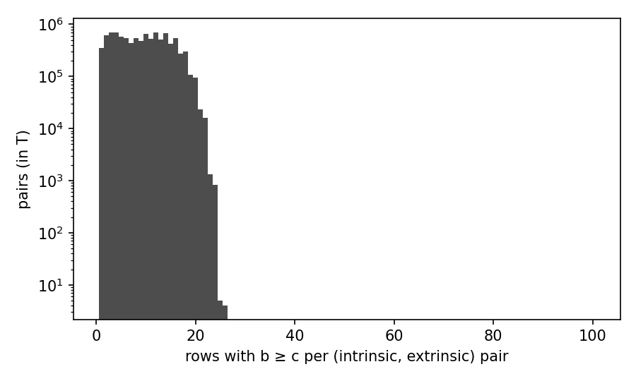
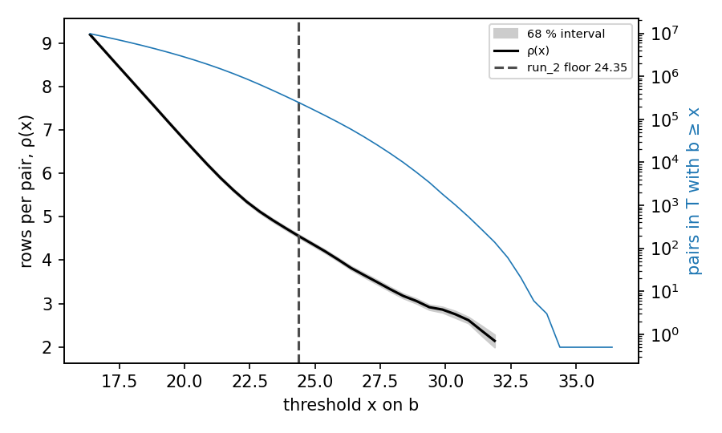

# Row reduction from marginalizing over phase, GW240525_201644

This report measures how many fewer rows dot-PE would need to keep for GW240525_201644 if it
stored one row per (intrinsic, extrinsic) pair, with the likelihood summed over the reference
phase, instead of one row per phase. That reduction tells whether phase marginalization alone,
or together with thinning, can bring the rows above the nominal cut within dot-PE's row limit.

Code and data: dot-PE branch `research` at commit 38f92b4; the rows are those of the E1
measurement (`research/rows-above-cut/2026-11-22_measurement.md`), recomputed from
GW240525_201644's production run (o4b-pe-paper `run_2`, dot-PE 2403731). It supersedes no
report.

## Question and answer

The question: in T, the complete set of rows with b ≥ c from E1's 120 sampled i-blocks (all
defined in Setup), what is ρ(c), the number of rows divided by the number of distinct
(intrinsic, extrinsic) pairs among them?

The answer: ρ(c) = 9.20 rows per pair (68 % bootstrap interval 9.18 to 9.22).

## Setup

A *row* is one (intrinsic, extrinsic, phase) combination, a *pair* one (intrinsic, extrinsic)
combination, (bank, i, e); each pair has n_phi = 100 reference phases on an equally spaced grid
(run_2 `run_kwargs.json`). b is a row's distance-maximized log-likelihood, (d|h)²/(2(h|h)) for
(d|h) > 0 (`bestfit_lnlike`, `dot_pe/thin_coherent.py:258`), and c = 16.379 is run_2's nominal
cut, its largest b over kept rows minus 20 (E1, Setup). T holds 9.12e7 rows from 120 of run_2's
1162 i-blocks, groups of up to 512 templates (E1).

### Rows per pair ρ(x)

    ρ(x) = Σ_k (B_k / n_b) R_k(x) / Σ_k (B_k / n_b) P_k(x),

with R_k(x) the rows with b ≥ x and P_k(x) the pairs with at least one row with b ≥ x, summed
over the sampled blocks of bank k, B_k the bank's number of i-blocks and n_b = 40 the sampled
ones (E1's stratum weights). The 68 % bootstrap interval resamples 40 blocks per bank with
replacement, 2000 times, as in E1.

## Results

How many phases does each pair have above the cut?

At x = c, pairs have between 1 and 26 of their 100 phases with b ≥ c, spread nearly evenly from
1 to 16 and falling off above 18.

How does ρ(x), the rows per pair with b ≥ x, change between the nominal cut and the best fit?

ρ(x) falls from 9.20 at c to 4.55 at x = 24.38, next to run_2's floor of 24.35. The request's
estimate of about 3 (from the top 1e7 rows of production runs, o4b-pe-paper
`dev/row_limit_check/phase_multiplicity.md`) refers to rows near the floor; at the floor of this
run ρ is 4.55, and at the nominal cut it is 9.20.

## Limitations

- A phase-marginalized cut would rank pairs by their marginalized likelihood, not by their best
  phase, so the pairs it keeps at a given budget differ from T's; ρ(c) is the reduction for
  T's pairs.
- One event; ρ depends on how sharply the likelihood varies with phase, which depends on the
  signal's higher modes and inclination.
- A phase-marginalized row must also carry what is needed to draw a phase later; its storage cost
  is not measured here.

## Reproduction

    python research/lsf_submit.py --name e4_rho --env o4a-pe -- research/phase-marginalization/rho.py

Output: `artifacts/research/phase-marginalization/` (`result.json`, `rho.csv`) and
`research/phase-marginalization/review/`. LSF job 422570, 22 s, 0.25 GB.
