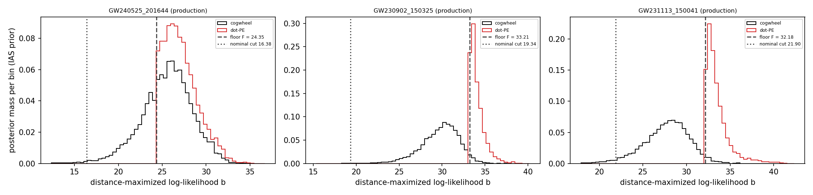
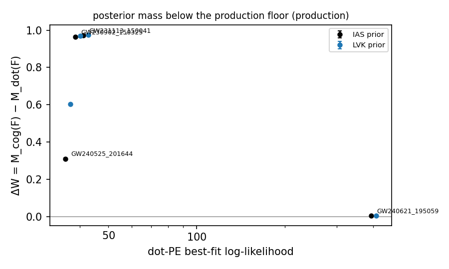

# Posterior mass removed by dot-PE's row limit

This report tests whether dot-PE's row limit removes posterior mass that an independent sampler,
cogwheel, finds. dot-PE keeps at most a fixed number of (intrinsic, extrinsic, phase)
combinations, ranked by their distance-maximized log-likelihood. When that limit binds, the
reported posterior is cut off below the lowest kept value, and at low signal-to-noise ratio that
cutoff can lie inside the bulk of the posterior.

Code and data: the test reads production outputs only. The dot-PE runs were made with dot-PE
2403731 (GW240525_201644 `run_2`, its `timing.json`) and the commits listed in o4b-pe-paper and
o4a-pe-paper `docs/pe/dot_pe_versions.csv`. The test script ran on branch `research` at commit f550319. It
supersedes no earlier report; its measure repeats, on four events, the one of
https://github.com/JonathanMushkin/o4b-pe-paper/blob/master/dev/row_limit_check/below_floor.md
(cited below as "the o4b-pe-paper check").

## Question and answer

The question: for each test event, what is ΔW, the posterior mass that cogwheel places at a
distance-maximized log-likelihood below dot-PE's production floor, minus the posterior mass
dot-PE places there (all three defined in Setup)?

The answer: under the IAS prior (dot-PE's production prior) ΔW is 0.004 for the control, an event
whose floor lies below nearly all of cogwheel's posterior, and 0.31, 0.96 and 0.97 for the three
low signal-to-noise-ratio (SNR) test events, each with a binomial standard error (Setup) of at most 0.005.

## Prediction

The design predicted: "dot-PE's production posterior has no mass below its floor by
construction, while cogwheel's has W_IAS = 0.31 for GW240525_201644, 0.97 for GW230902_150325
and 0.97 for GW231113_150041, so ΔW ≈ W. The prediction is disproved if ΔW is within its noise
of 0 for any of the three low-SNR events." Here W_IAS and W are the o4b-pe-paper check's names
for M_cog(F), cogwheel's posterior mass below the floor, under the IAS prior. The prediction
held: ΔW is 0.31, 0.96 and 0.97 for the three events, more than 60 times its standard error in
each.

## Setup

dot-PE scores every (intrinsic, extrinsic, phase) combination of a run, a *row*. It keeps at
most `size_limit` = 1e7 rows (`dot_pe/mp_inference.py:600`), those with the highest b defined
below; all 288 production runs of the two paper repos kept exactly 1e7 rows (o4b-pe-paper
`dev/row_limit_check/row_limit.csv`, column `rows_kept`).

### Distance-maximized log-likelihood b

For a template with matched-filter inner products (d|h), of data and template, and (h|h), of the
template with itself, at a reference distance,

    b = (d|h)² / (2 (h|h))   if (d|h) > 0,   else 0,

the log-likelihood maximized over luminosity distance. dot-PE stores it per row as
`bestfit_lnlike` (`dot_pe/thin_coherent.py:258`). For a cogwheel posterior sample it is computed
from the stored `lnl` = (d|h) − (h|h)/2 and `h_h` = (h|h), with (d|h) = lnl + h_h/2; b does not
depend on the distance at which the inner products are evaluated.

### Best fit and nominal cut

The best fit of a dot-PE run is the largest b over its kept rows, and of a cogwheel run the
largest b over its samples. dot-PE intends to keep every row with

    b ≥ (best fit) − 20,

the *nominal cut*, 20 in log-likelihood below the best fit (`max_bestfit_lnlike_diff`,
`dot_pe/mp_inference.py:607`).

### Floor F

    F = min over the run's kept rows of b,

the lowest b dot-PE kept. When `size_limit` binds, F lies above the nominal cut.

### Mass below the floor M_s(F) and ΔW

For sampler s (dot-PE or cogwheel) with posterior samples j of weights w_j,

    M_s(F) = Σ_{j: b_j < F} w_j / Σ_j w_j,

the posterior mass with b below F, and

    ΔW = M_cog(F) − M_dot(F).

### Standard error of ΔW

With the Kish effective sample size of sampler s,

    n_eff,s = (Σ_j w_j)² / Σ_j w_j²,

the binomial standard error of M_s(F) is σ_s = √(M_s(F) (1 − M_s(F)) / n_eff,s), and

    σ_ΔW = √(σ_cog² + σ_dot²).

### Priors and samples

Under the IAS prior dot-PE's samples are `samples.feather` (1e4 equally weighted draws) and
cogwheel's its production `samples.feather`. Under the LVK prior (the LVK spin and distance prior,
as implemented in o4b-pe-paper `src/o4a_pe_paper/pe_lib/lvk_reweight.py`) dot-PE's samples are
`samples_lvc.feather`, and cogwheel's are a cogwheel run sampled under the LVK prior where one
exists (GW240525_201644) and otherwise the production samples reweighted to the LVK prior.

### Events

All columns but the first three are values of b, in log-likelihood.

| event | role | dot-PE run | floor F | dot-PE best fit | cogwheel best fit | offset (dot-PE − cogwheel) |
|---|---|---|---|---|---|---|
| GW240621_195059 | control | o4b `run_1` | 385.0 | 401.2 | 401.7 | −0.5 |
| GW240525_201644 | test | o4b `run_2` | 24.35 | 36.38 | 35.67 | 0.7 |
| GW230902_150325 | test | o4a `run_2` | 33.21 | 39.34 | 37.49 | 1.8 |
| GW231113_150041 | test, not counted toward a fix | o4a `run_0` | 32.18 | 41.90 | 36.38 | 5.5 |

The three test events were chosen, after the o4b-pe-paper check, as two of the five events with
the largest M_cog(F) and that check's featured event; the control was chosen by hand, among the six events of that check's table with best fit above 200
and offset below 2 in magnitude, as the one with the smallest larger value of M_cog(F) under the
two priors (0.004).
F is fixed per event in `test_mass_below_floor.py`, so a later run of the same test on fixed
dot-PE runs evaluates the same F. GW231113_150041 is not counted toward accepting a fix because
its offset of 5.5 can keep ΔW above 0 under a correct fix.

## Results

Where does the posterior mass lie in b, the distance-maximized log-likelihood, relative to F and
the nominal cut, for the control?

All but 0.004 of cogwheel's posterior lies above F = 385.0, as does all of dot-PE's.

Where does it lie for the three test events?

For GW240525_201644 about a third of cogwheel's posterior lies below F; for GW230902_150325 and
GW231113_150041 nearly all of it does, while dot-PE's posterior is confined to b ≥ F.

How large is ΔW, cogwheel's minus dot-PE's posterior mass below F, across the four events under
each prior?

ΔW is 0.004 for the control and 0.31 to 0.97 for the test events under both priors; the error
bars, σ_ΔW, are smaller than the markers. The values:

| event | ΔW, IAS prior (σ_ΔW) | ΔW, LVK prior (σ_ΔW) | n_eff,cog, LVK prior |
|---|---|---|---|
| GW240621_195059 | 0.004 (0.001) | 0.004 (0.003) | 474 |
| GW240525_201644 | 0.310 (0.005) | 0.602 (0.004) | 12 467 |
| GW230902_150325 | 0.964 (0.002) | 0.969 (0.007) | 555 |
| GW231113_150041 | 0.971 (0.002) | 0.974 (0.005) | 874 |

M_dot(F), dot-PE's mass below F, is 0 by construction up to the rounding of F in the events table, so
ΔW here equals M_cog(F).

## Limitations

- ΔW measures where in b (the distance-maximized log-likelihood) the posterior mass lies, not
  whether the parameter values within that range carry the right weights; a fix could reach
  ΔW ≈ 0 with wrong weights. The weights are tested in a separate experiment
  (`research/weight-thinning/`).
- Cogwheel's and dot-PE's b come from two likelihood implementations; the offsets in the events
  table bound their disagreement at the best fit. For GW231113_150041 part of ΔW may come from a
  different maximum, not from the row limit.
- Under the LVK prior three events rest on reweighted cogwheel samples with Kish effective sample
  sizes n_eff,cog of 474 to 874 (table above).

## Reproduction

    python research/lsf_submit.py --name e0_mass_below_floor --env o4a-pe --mem-mb 8000 \
        -- research/row-limit/test_mass_below_floor.py

Output: `artifacts/research/row-limit/mass_below_floor_production.csv` (named per run tag, design note of
2026-11-22 10:40) and the figures in
`research/row-limit/review/`.

Line numbers in citations of `dot_pe/` refer to commit 38f92b4 (before `row_thinning` was added).
