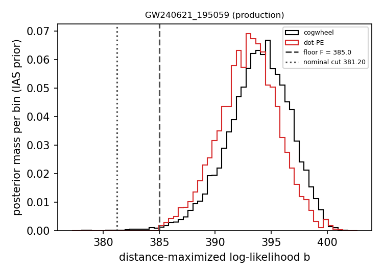

# Posterior mass removed by dot-PE's row limit

This report tests whether dot-PE's row limit removes posterior mass that an independent sampler,
cogwheel, finds. dot-PE keeps at most `size_limit` (intrinsic, extrinsic, phase) rows, ranked by
their distance-maximized log-likelihood. When that limit binds, the reported posterior is cut off
below the lowest kept value, and at low signal-to-noise ratio that cutoff can lie inside the
bulk of the posterior.

Code and data: the test reads production outputs only. The dot-PE runs were made with dot-PE
2403731 (GW240525_201644 `run_2`) and the commits listed in o4b-pe-paper
`docs/pe/dot_pe_versions.csv` and o4a-pe-paper `docs/pe/dot_pe_versions.csv`. The test script
ran on branch `research` (dcfaad4). It supersedes no earlier report; the measurement it repeats
on four events was first made in
https://github.com/JonathanMushkin/o4b-pe-paper/blob/master/dev/row_limit_check/below_floor.md

## Question and answer

The question: for each test event, what is ΔW, the posterior mass that cogwheel places at a
distance-maximized log-likelihood below dot-PE's production floor, minus the mass dot-PE places
there?

The answer: under the IAS prior ΔW is 0.004 for the high-SNR control and 0.31, 0.96 and 0.97
for the three low-SNR test events, each with a noise below 0.005.

## Prediction

The design predicted: "dot-PE's production posterior has no mass below its floor by
construction, while cogwheel's has W_IAS = 0.31 for GW240525_201644, 0.97 for GW230902_150325
and 0.97 for GW231113_150041, so ΔW ≈ W. The prediction is disproved if ΔW is within its noise
of 0 for any of the three low-SNR events." It held: ΔW is 0.31, 0.96 and 0.97 for the three
events, more than 60 times its noise in each.

## Setup

dot-PE scores every (intrinsic, extrinsic, phase) combination of a run, a *row*, and keeps the
rows whose distance-maximized log-likelihood lies within 20 of the run's best fit, the *nominal
cut*. On top of that it keeps at most `size_limit` = 1e7 rows, those with the highest
distance-maximized log-likelihood. Every production run hit that limit. The *floor* F of a run is
the lowest distance-maximized log-likelihood among its kept rows.

### Distance-maximized log-likelihood b

For a template with matched-filter inner products (d|h) and (h|h) at a reference distance,

    b = (d|h)² / (2 (h|h))   if (d|h) > 0,   else 0,

the log-likelihood maximized over luminosity distance. dot-PE stores it per row as
`bestfit_lnlike` (`dot_pe/thin_coherent.py:258`). For a cogwheel posterior sample it is computed
from the stored `lnl` = (d|h) − (h|h)/2 and `h_h` = (h|h) at the sample's distance, with
(d|h) = lnl + h_h/2; the value does not depend on the distance at which the inner products are
evaluated.

### Mass below the floor M_s(F) and ΔW

For sampler s (dot-PE or cogwheel) with posterior samples of weights w_j,

    M_s(F) = Σ_{j: b_j < F} w_j / Σ_j w_j,

the posterior mass with b below F, and

    ΔW = M_cog(F) − M_dot(F).

The noise of ΔW is the binomial standard error of each M, √(M(1 − M)/n_eff), with n_eff the Kish
effective sample size (Σw)²/Σw², added in quadrature.

### Priors and samples

Under the IAS prior (dot-PE's production prior) dot-PE's samples are `samples.feather` (1e4
equally weighted draws) and cogwheel's its production `samples.feather`. Under the LVK prior
(the LVK spin and distance prior, as implemented in o4b-pe-paper
`src/o4a_pe_paper/pe_lib/lvk_reweight.py`) dot-PE's samples are `samples_lvc.feather`, and
cogwheel's are a cogwheel run sampled under the LVK prior where one exists (GW240525_201644) and
otherwise the production samples reweighted to the LVK prior.

### Events

| event | role | dot-PE run | floor F | dot-PE best fit | cogwheel best fit | offset |
|---|---|---|---|---|---|---|
| GW240621_195059 | control | o4b `run_1` | 385.0 | 401.2 | 401.7 | −0.5 |
| GW240525_201644 | test | o4b `run_2` | 24.35 | 36.38 | 35.67 | 0.7 |
| GW230902_150325 | test | o4a `run_2` | 33.21 | 39.34 | 37.49 | 1.8 |
| GW231113_150041 | test (reported, not counted for E5) | o4a `run_0` | 32.18 | 41.90 | 36.38 | 5.5 |

Best fits are the largest b over a run's kept rows (dot-PE) or over the samples (cogwheel);
the offset is dot-PE's minus cogwheel's, in log-likelihood. The three test events are the
handoff's acceptance events and were chosen after its results; the control is the event with
best fit above 200, offset below 2 in magnitude, and the smallest W_IAS above 0 in o4b-pe-paper
`dev/row_limit_check/below_floor.csv`. F is fixed in `test_mass_below_floor.py` per event, so the
solution experiment evaluates the same F.

## Results

Where do the two posteriors lie in b, relative to the floor and the nominal cut, for the
control?

For the high-SNR control both posteriors lie above F = 385.0, and the floor removes nothing that
cogwheel finds.

Where do they lie for the three test events?

For GW240525_201644 about a third of cogwheel's posterior lies between the nominal cut and F;
for GW230902_150325 and GW231113_150041 nearly all of it does, and dot-PE's posterior is
confined to b ≥ F.

How large is ΔW across the four events, under each prior?

ΔW per event (noise in parentheses):

| event | ΔW, IAS prior | ΔW, LVK prior |
|---|---|---|
| GW240621_195059 | 0.004 (0.001) | 0.004 (0.003) |
| GW240525_201644 | 0.310 (0.005) | 0.602 (0.004) |
| GW230902_150325 | 0.964 (0.002) | 0.969 (0.007) |
| GW231113_150041 | 0.971 (0.002) | 0.974 (0.005) |

M_dot(F) is 0 up to the rounding of F (at most 0.002) by construction, since F is the lowest
kept b; ΔW therefore equals M_cog(F) here.

## Observations after the experiment

Not asked by the question: the nominal cut drawn in the figures is dot-PE's best fit over kept
rows minus 20, which for GW240525_201644 is 16.38, not the 15.29 of the handoff; the handoff took
the best fit from `summary_results.json`, whose `bestfit_lnlike_max` is the maximum over the
posterior draws (`dot_pe/inference.py:1568`), not over the rows (`research/progress.md`,
2026-11-22 10:27).

## Limitations

- ΔW measures where in b the posterior mass lies, not whether the parameters within that region
  are right; a fix could reach ΔW ≈ 0 with wrong weights. E3 tests the weights.
- Cogwheel's and dot-PE's b come from two likelihood implementations; the offsets in the events
  table bound their disagreement at the best fit. For GW231113_150041 the offset of 5.5 means
  part of ΔW may come from a different maximum, not from the row limit.
- The LVK-prior values for three events rest on reweighted cogwheel samples with n_eff of 474
  to 874.

## Reproduction

    python research/lsf_submit.py --name e0_mass_below_floor --env o4a-pe --mem-mb 8000 \
        -- research/row-limit/test_mass_below_floor.py

Output: `artifacts/research/row-limit/mass_below_floor_production.csv` and the figures in
`research/row-limit/review/`. LSF jobs 384729 and 390492 (figure range).
