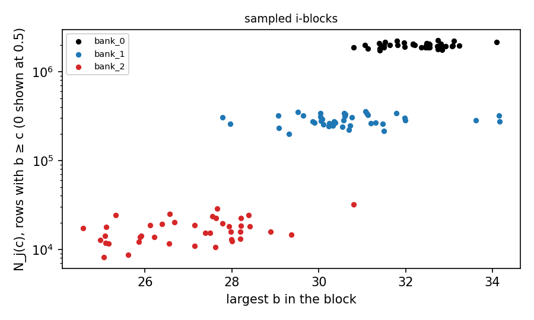
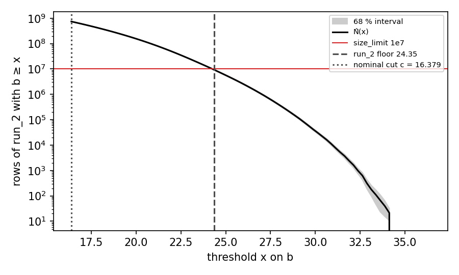

# Rows above the nominal cut in GW240525_201644

This report measures how many (intrinsic, extrinsic, phase) rows dot-PE's coherent stage would
keep for GW240525_201644 if it kept every row it intends to, that is, without its row limit. The
number sets how far any fix must reach: raising the row limit, using fewer samples, or thinning
the rows.

Code and data: dot-PE branch `research` at commits dcfaad4 (3 pilot blocks) and 96e02af (117 blocks),
and 38f92b4 for the analysis; the worker is the production one, `dot_pe.thin_coherent.run_thin_iblock`
(dot-PE 4516a13 with the two merged branches). The data are GW240525_201644's production run
(o4b-pe-paper `run_2`, made with dot-PE 2403731): its selected templates, extrinsic samples and
coherent setup. It supersedes no report.

## Question and answer

The question: how many rows of GW240525_201644 run_2 have a distance-maximized log-likelihood b
at or above the nominal cut c = 16.379 (both defined in Setup)?

The answer: N̂(c), the estimated number of such rows, is 7.40e8 (68 % bootstrap interval 7.34e8
to 7.47e8), 74 times dot-PE's row limit of 1e7.

## Setup

A *row* is one (intrinsic, extrinsic, phase) combination; run_2 has 594 510 selected templates,
13 312 extrinsic samples and 100 reference phases, 7.9e11 rows. dot-PE keeps at most
`size_limit` = 1e7 rows (`dot_pe/mp_inference.py:600`).

### Distance-maximized log-likelihood b

    b = (d|h)² / (2 (h|h))   if (d|h) > 0,   else 0,

with (d|h) and (h|h) the matched-filter inner products of data and template and of the template
with itself; dot-PE stores it as `bestfit_lnlike` (`dot_pe/thin_coherent.py:258`).

### Nominal cut c

    c = (largest b over run_2's kept rows) − 20 = 36.379 − 20 = 16.379,

the cut dot-PE intends (`max_bestfit_lnlike_diff` = 20). The largest b is read from run_2's
`prob_samples.feather`; the `bestfit_lnlike_max` of `summary_results.json`, 35.287, is the
maximum over the posterior draws (`dot_pe/inference.py:1568`) and is not used.

### Recomputation

The coherent stage is recomputed one i-block at a time, an *i-block* being a group of up to 512
selected templates of one bank (`dot_pe/mp_inference.py:433`), with the production worker
called on run_2's saved setup without the per-block row cap. Each call covers one block of 512
extrinsic samples, and its output is filtered to b ≥ 15.287, a superset of b ≥ c. The worker's
own threshold never exceeds c, so no row with b ≥ c is lost.

Validation: every one of the 3 066 717 rows that run_2 kept from the sampled blocks is found
in the recomputation with the same (i, e, o) and the same b to 3e-15 relative; none is missing.

### Sample and estimator

From each of run_2's three banks, 40 i-blocks were drawn at random without replacement (seed
20261122): 120 of the 1162 i-blocks. With B_k the number of i-blocks of bank k (309, 428 and
425), n_b = 40, and N_j(x) the number of rows of block j with b ≥ x,

    N̂(x) = Σ_k (B_k / n_b) Σ_{j sampled in bank k} N_j(x).

The 68 % bootstrap interval is the 16th to 84th percentile of N̂(x) over 2000 resamplings, with
replacement, of 40 blocks within each bank.

## Results

How are one block's rows distributed in b, from c to its largest value?

In bank_0's first sampled block (block 74) the number of rows per 0.25 bin of b grows from 1 at
the block's largest b, 31.06, to 1.7e5 at c, about five orders of magnitude.

How much do blocks differ in N_j(c), the number of their rows with b ≥ c?

N_j(c) is set mainly by the bank: median 2.0e6 rows per block in bank_0, 2.8e5 in bank_1 and
1.6e4 in bank_2, each within about a factor 2 across that bank's blocks; the five largest blocks
hold 12 % of the sampled rows.

How does N̂(x), the estimated number of run_2's rows with b ≥ x, grow as x decreases from the
best fit to c?

N̂(x) grows by a factor of 2.8 between x = c + 2.5 and x = c, and by a factor of 81 between
run_2's floor and c. It crosses
`size_limit` = 1e7 at x ≈ 24.3; at x = 24.38 it is 9.1e6 (68 % interval 8.8e6 to 9.4e6), close
to run_2's floor of 24.35, the lowest b it kept. At c, N̂(c) = 7.40e8, of which bank_0 holds
6.1e8, bank_1 1.2e8 and bank_2 7.2e6.

## Limitations

- One event. Events with a lower best fit have more of their rows near the cut (o4b-pe-paper
  `dev/row_limit_check/README.md`), so N̂(c)/`size_limit` is expected to vary across events; it
  is not measured here.
- The sampled blocks do not include the template with run_2's largest b (their largest b is
  34.2), so N̂(x) near the best fit is not resolved; at c the interval carries the block-to-block
  spread.
- The recomputation uses dot-PE 4516a13 plus two merged branches, run_2 dot-PE 2403731; the
  validation above found no row of run_2 changed.

## Reproduction

    python research/rows-above-cut/harness.py --plan
    python research/lsf_submit.py --name e1_blocks --env dot-pe -- \
        research/rows-above-cut/harness.py --blocks <positions>     # 0 to 119, 20 LSF jobs
    python research/lsf_submit.py --name e1_analyze --env dot-pe -- research/rows-above-cut/analyze.py

Output: `artifacts/research/rows-above-cut/` (`result.json`, `n_hat.csv`, `per_block.csv`,
`blocks/`) and `research/rows-above-cut/review/`. One block takes 460 to 630 s on one core and
peaks at 8.9 GB.
