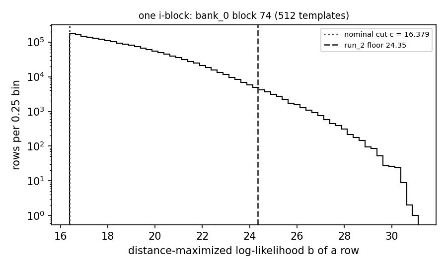

# Rows above the nominal cut in GW240525_201644

This report measures how many (intrinsic, extrinsic, phase) rows dot-PE's coherent stage would
keep for GW240525_201644 if it kept every row it intends to, that is, without its row limit. The
number sets how far any fix must reach: raising the row limit, using fewer samples, or thinning
the rows.

Code and data: dot-PE branch `research` at commits dcfaad4 (3 pilot blocks) and 96e02af (117
blocks), and 38f92b4 for the analysis. The worker is the production one,
`dot_pe.thin_coherent.run_thin_iblock`, as on branch `size-limit`: dot-PE 4516a13 with the
branches `bugfix-incoherent-bound-mask` and `seed-pool-inds` merged. The data are
GW240525_201644's production run (o4b-pe-paper `run_2`, made with dot-PE 2403731): its selected
templates, extrinsic samples and coherent setup. It supersedes no report.

## Question and answer

The question: how many rows of GW240525_201644 run_2 have a distance-maximized log-likelihood b
at or above c = 16.379, the largest b over run_2's kept rows minus 20 (both defined in Setup)?

The answer: N̂(c), the estimated number of such rows, is 7.40e8 (68 % bootstrap interval 7.34e8
to 7.47e8), 74 times dot-PE's row limit of 1e7.

## Setup

A *row* is one (intrinsic, extrinsic, phase) combination, indexed (i, e, o): the template, the
extrinsic sample and the reference phase. run_2 has 594 510 selected templates, 13 312 extrinsic
samples and 100 reference phases, 7.9e11 rows. dot-PE keeps at most `size_limit` = 1e7 rows
(`dot_pe/mp_inference.py:600`), the *row limit*.

### Distance-maximized log-likelihood b

    b = (d|h)² / (2 (h|h))   if (d|h) > 0,   else 0,

with (d|h) and (h|h) the matched-filter inner products of data and template and of the template
with itself; dot-PE stores it as `bestfit_lnlike` (`dot_pe/thin_coherent.py:258`). The *best fit*
is run_2's largest b, 36.379, read from its `prob_samples.feather`; the *floor* is the lowest b
run_2 kept, 24.35.

### Nominal cut c

    c = (best fit) − 20 = 36.379 − 20 = 16.379,

the cut dot-PE intends (`max_bestfit_lnlike_diff` = 20).

### Recomputation

The coherent stage is recomputed one i-block at a time, an *i-block* being a group of up to 512
selected templates of one bank (`dot_pe/mp_inference.py:433`). The production worker is called
on run_2's saved setup with `max_output_per_block` = None, which removes its per-block cap on the
rows it returns (64 724 rows per block for bank_0 in run_2). Each call covers one block of 512
extrinsic samples, and its output is filtered to b ≥ 15.287, below c, so every row with b ≥ c is
kept; the worker's own threshold never exceeds c.

Validation: every one of the 3 066 717 rows that run_2 kept from the sampled blocks is found in
the recomputation with the same (i, e, o) and the same b, to a largest relative difference of
3e-15 (compared in double precision before storage; the design's tolerance is 1e-5); none is
missing.

### Sample and estimator

From each of run_2's three banks, 40 i-blocks were drawn at random without replacement (seed
20261122): 120 of the 1162 i-blocks. With B_k the number of i-blocks of bank k (309, 428 and
425), n_b = 40, and N_j(x) the number of rows of block j with b ≥ x,

    N̂(x) = Σ_k (B_k / n_b) Σ_{j sampled in bank k} N_j(x).

N̂ is evaluated on a grid of x in steps of 0.25 starting at 16.379, c rounded to three decimals;
the rounding adds 1e-4 relative to the counts at c.

### 68 % bootstrap interval

With N̂*(x) the same sum over 40 blocks per bank drawn with replacement from that bank's sampled
blocks, repeated 2000 times,

    interval = [16th percentile of N̂*(x), 84th percentile of N̂*(x)].

## Results

How are one block's rows distributed in b, the distance-maximized log-likelihood, from c, the
nominal cut, to the block's largest value?

In bank_0's first sampled block (block 74) the number of rows per 0.25 bin of b grows from 1 at
the block's largest b, 31.06, to 1.7e5 at c, about five orders of magnitude.

How much do blocks differ in N_j(c), the number of their rows with b ≥ c?

N_j(c) is set mainly by the bank, bank_0's blocks holding the most and bank_2's the fewest; within
a bank it varies by a factor of 1.3 (bank_0), 1.8 (bank_1) and 3.9 (bank_2).

How does N̂(x), the estimated number of run_2's rows with b ≥ x, grow as x decreases from the
best fit (run_2's largest b) to c?

N̂(x) crosses the row limit, 1e7, at x ≈ 24.3; at x = 24.38 it is 9.1e6 (68 % interval 8.8e6 to
9.4e6), next to the floor, the lowest b run_2 kept, 24.35. From the floor to c it grows by a
factor of 81, to N̂(c) = 7.40e8.

## Limitations

- One event. Events with a lower best fit have more of their rows near the cut (o4b-pe-paper
  `dev/row_limit_check/README.md`), so the ratio of N̂(c), the rows above the nominal cut, to the
  row limit is expected to vary across events; it is not measured here.
- The sampled blocks do not include the template with run_2's largest b (their largest b is
  34.2), so N̂(x), the estimated row count, is not resolved near the best fit; at c the interval
  carries the block-to-block spread.
- The recomputation uses a later dot-PE than run_2 (above); the validation found no row of run_2
  changed.

## Reproduction

    python research/rows-above-cut/harness.py --plan
    python research/lsf_submit.py --name e1_blocks --env dot-pe -- \
        research/rows-above-cut/harness.py --blocks <positions>     # 0 to 119, 20 LSF jobs
    python research/lsf_submit.py --name e1_analyze --env dot-pe -- research/rows-above-cut/analyze.py

Output: `artifacts/research/rows-above-cut/` (`result.json`, `n_hat.csv`, `per_block.csv`,
`blocks/`) and `research/rows-above-cut/review/`. One block takes 460 to 630 s on one core and
peaks at 8.9 GB.

Line numbers in citations of `dot_pe/` refer to commit 38f92b4 (before `row_thinning` was added).
