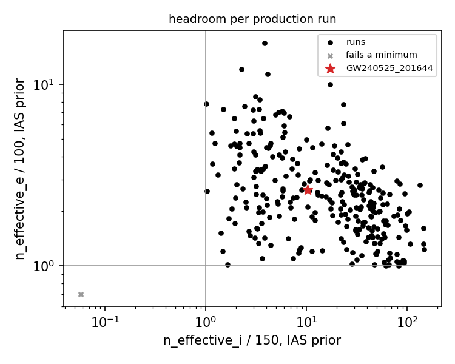

# How far fewer templates and fewer extrinsic samples could shrink dot-PE's rows

This report measures how much room the production runs have to use fewer templates or fewer
extrinsic samples, two ways to put fewer (intrinsic, extrinsic, phase) rows against dot-PE's row
limit. Both are bounded by the minimum effective sample sizes the analysis demands, so the room
is the factor by which those effective sample sizes exceed their minima.

Code and data: the script ran on the login node on 2026-11-22 at 10:30, when branch `research`
was at commit 96e02af (its `git log`; the run is logged in `research/progress.md`), and reads the
production summaries of the 288 runs in o4b-pe-paper `dev/row_limit_check/row_limit.csv` (dot-PE
commits as recorded per run in each paper repo's `docs/pe/dot_pe_versions.csv`). It supersedes
no report.

## Question and answer

The question: for each production run, what is H, the largest factor by which the rows could be
reduced by fewer templates and fewer extrinsic samples while n_effective_i, the effective number
of distinct templates, stays at least 150 and n_effective_e, the effective number of distinct
extrinsic samples, at least 100, under both the IAS prior (dot-PE's production prior) and the
LVK prior (the LVK spin and distance prior), if each scales in proportion to its number of
samples?

The answer: 175 of the 288 runs already fail one of the two minima and have no such room; for
the other 113, H has a median of 4.7 (quartiles 2.7 and 7.7) and a maximum of 29.

## Setup

A *row* is one (intrinsic, extrinsic, phase) combination; dot-PE keeps at most `size_limit` =
1e7 rows. The IAS-prior values are read from each run's `summary_results.json`, the LVK-prior
values from `summary_results_lvc.json` (present for all 288 runs). The minima 150 and 100 are
`MIN_NEFF_I` and `MIN_NEFF_E` of o4b-pe-paper `src/o4a_pe_paper/pe_lib/failure_modes.py`.

### Effective sample sizes

With p_r the normalized weight of row r, P_i the sum of p_r over the rows of template i and
P_e over the rows of extrinsic sample e (`get_n_effective_total_i_e`,
`dot_pe/base_sampler_free_sampling.py`),

    n_effective_i = 1 / Σ_i P_i²,      n_effective_e = 1 / Σ_e P_e².

### Headroom ratios h_i and h_e

With p running over the two priors,

    h_i = min_p n_effective_i,p / 150,      h_e = min_p n_effective_e,p / 100.

A run with h_i < 1 or h_e < 1 already fails a minimum.

### Row reduction H

For a run with h_i ≥ 1 and h_e ≥ 1,

    H = h_i × h_e.

If n_effective_i scales in proportion to the number of templates and n_effective_e to the number
of extrinsic samples, using h_i times fewer templates and h_e times fewer extrinsic samples
reduces the rows by H and leaves both at their minima. Quoting H only for runs that pass both
minima was decided after the results (`design.md`, design note of 2026-11-22 12:05); it does not
change the definition.

### Reduction needed, R

For GW240525_201644 the rows above the nominal cut (its best fit over kept rows minus 20) number
N̂(c) = 7.40e8 (E1, `research/rows-above-cut/2026-11-22_measurement.md`), so keeping all of
them within `size_limit` needs a reduction R = N̂(c) / 1e7 = 74.

## Results

How much headroom does each run have in n_effective_i and in n_effective_e?

Of the 288 runs, 163 have h_i < 1 (fewer than 150 effective templates under one prior), 25 have
h_e < 1, and 13 both; 113 pass both. GW240525_201644 run_2 has h_i = 1.5 and h_e = 0.98: its
n_effective_e under the LVK prior is 98.

What is H, the row reduction the minima allow, against the best-fit log-likelihood, the largest b
over the posterior draws (`bestfit_lnlike_max`)?

For the 113 runs that pass both minima, H is between 1.2 and 29, median 4.7. Failing runs are
drawn as grey crosses at max(1, h_i) × max(1, h_e), which is not a reduction they could make. GW240525_201644 fails the n_effective_e minimum, so it has no room; even
the largest H of any run, 29, is below the R = 74 this event needs.

## Limitations

- H assumes n_effective_i scales with the number of templates and n_effective_e with the number
  of extrinsic samples. The
  one test available contradicts it: GW240525_201644 with the first eighth of each bank had
  n_effective_i 363 instead of 1535 under the IAS prior (4.2 times lower for 8 times fewer
  templates) and n_effective_e 329 instead of 262, because the floor (the lowest kept b) moved
  too (o4b-pe-paper `dev/row_limit_check/gw240525_runs.md`).
- H multiplies h_i and h_e as if independent; the same test shows they are not.
- The summaries are read as they are on disk. Every `summary_results.json` was written after the
  cross-bank n_effective fix (dot-PE 2403731, 2026-07-13 13:44); the earliest, 11 minutes after
  it, belongs to a run made with an older commit, so its summary was rewritten later by a dot-PE
  version not recorded in it.
- The x-axis of figure 2 is `bestfit_lnlike_max` of `summary_results.json`, the maximum over the
  1e4 posterior draws, which is below the best fit over rows; it only orders runs by
  signal-to-noise ratio.
- R is measured for one event only (E1).

## Reproduction

    python research/sample-headroom/headroom.py     # env o4a-pe, login node, seconds

Output: `artifacts/research/sample-headroom/headroom.csv` and `research/sample-headroom/review/`.

