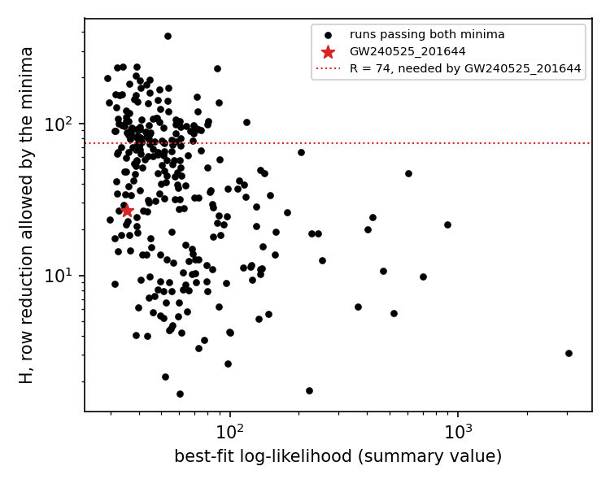

# How far fewer templates and fewer extrinsic samples could shrink dot-PE's rows

This report measures how much room the production runs have to use fewer templates or fewer
extrinsic samples, two ways to put fewer (intrinsic, extrinsic, phase) rows against dot-PE's row
limit. Both are bounded by the minimum effective sample sizes the analysis demands, so the room
is the factor by which those effective sample sizes exceed their minima.

Code and data: the script reads the production summaries of the 288 runs in o4b-pe-paper
`dev/row_limit_check/row_limit.csv` (dot-PE commits as recorded per run in each paper repo's
`docs/pe/dot_pe_versions.csv`); it ran on branch `research` (dcfaad4 and later). It supersedes no
report.

## Question and answer

The question: for each production run, what is H, the largest factor by which the rows could be
reduced by fewer templates and fewer extrinsic samples while n_effective_i ≥ 150 and
n_effective_e ≥ 100 under both the IAS and LVK priors, if each effective sample size scales in
proportion to its number of samples?

The answer: H has a median of 3.0 over the 288 runs (quartiles 2.0 and 5.3), and 175 runs
already fall below one of the two minima, most of them through n_effective_i under the LVK prior.

## Setup

n_effective_i and n_effective_e are the effective numbers of distinct intrinsic samples
(templates) and of distinct extrinsic samples among a run's weighted rows,
`get_n_effective_total_i_e` in `dot_pe/base_sampler_free_sampling.py`. The minima, 150 and 100,
are `MIN_NEFF_I` and `MIN_NEFF_E` of o4b-pe-paper `src/o4a_pe_paper/pe_lib/failure_modes.py`.
The IAS-prior values are read from each run's `summary_results.json`, the LVK-prior values from
`summary_results_lvc.json` (present for all 288 runs).

### Headroom ratios h_i and h_e

With p running over the two priors,

    h_i = min_p n_effective_i,p / 150,      h_e = min_p n_effective_e,p / 100.

A run with h_i < 1 or h_e < 1 already fails a minimum.

### Row reduction H

    H = max(1, h_i) × max(1, h_e).

If n_effective_i scales in proportion to the number of templates and n_effective_e to the number
of extrinsic samples n_ext, using h_i times fewer templates and h_e times fewer extrinsic samples
reduces the rows by H and leaves both at their minima.

## Results

How much headroom does each run have in n_effective_i and in n_effective_e?

Of the 288 runs, 163 have h_i < 1 and 25 have h_e < 1 (13 both); in 286 runs the LVK prior gives
the smaller n_effective_i. GW240525_201644 run_2 has h_i = 1.5 and h_e = 0.98 (n_effective_e 98
under the LVK prior).

What is H against the best-fit log-likelihood?

H is at most 29 (one run); its median is 3.0 over all runs and 4.7 over the 113 runs that pass
both minima. For GW240525_201644, H = 1.5. The reduction this event needs to reach its nominal
cut, R = N̂(c) / `size_limit`, comes from E1 (`research/rows-above-cut/`) and is compared here
once E1 has reported.

## Limitations

- H assumes n_effective_i scales with the number of templates and n_effective_e with n_ext. The
  one test available contradicts it: GW240525_201644 with the first eighth of each bank had
  n_effective_i 363 instead of 1535 under the IAS prior (4.2 times lower for 8 times fewer
  templates) and n_effective_e 329 instead of 262, because the floor moved too
  (o4b-pe-paper `dev/row_limit_check/gw240525_runs.md`).
- H multiplies h_i and h_e as if independent; the same test shows they are not.
- The x-axis of figure 2 is `bestfit_lnlike_max` of `summary_results.json`, the maximum over the
  1e4 posterior draws, which is below the best fit over rows; it only orders runs by
  signal-to-noise ratio.

## Reproduction

    python research/sample-headroom/headroom.py     # env o4a-pe, login node, seconds

Output: `artifacts/research/sample-headroom/headroom.csv` and `research/sample-headroom/review/`.
