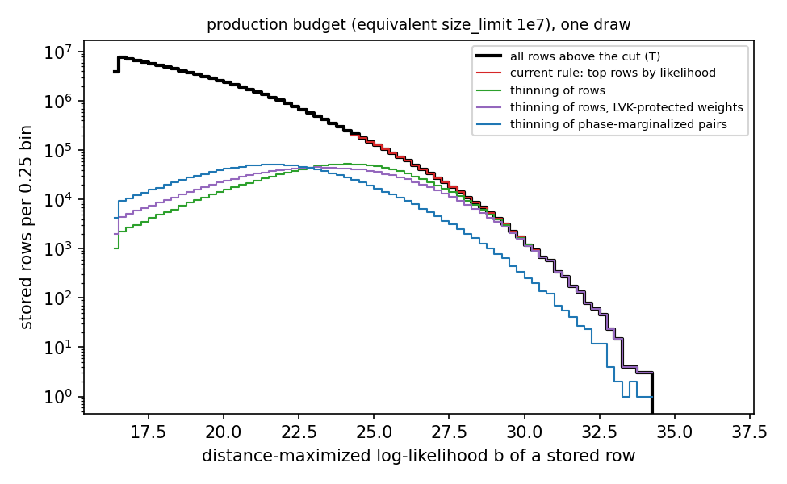
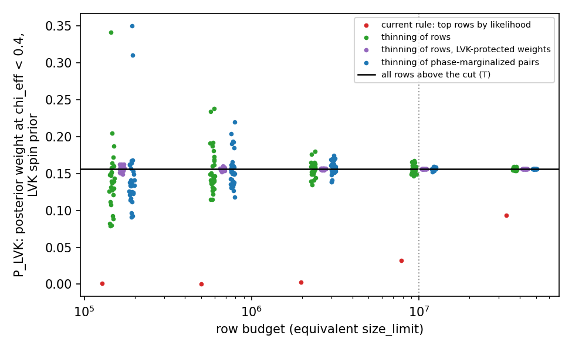
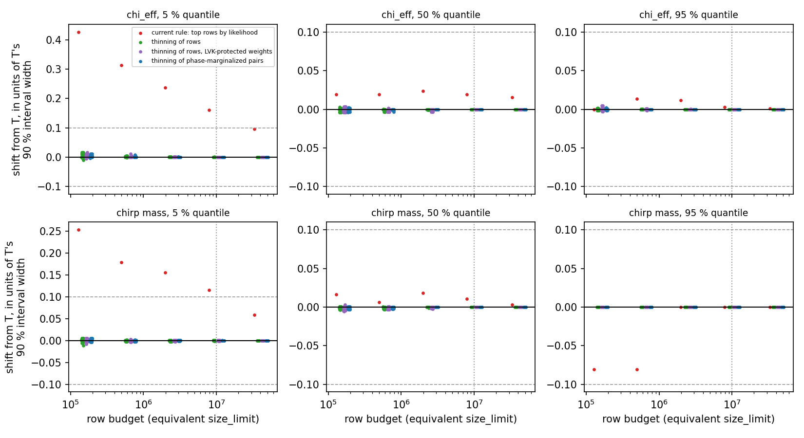
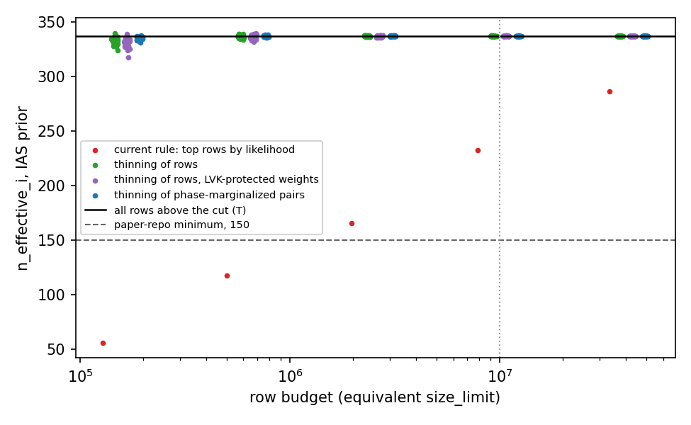

# Keeping a random, reweighted subset of dot-PE's rows instead of the most likely ones

dot-PE can store only a fixed number of (intrinsic, extrinsic, phase) combinations, and today it
stores the ones with the highest likelihood, which cuts off the part of the posterior that lies at
lower likelihood. This report tests the alternative: store a random subset in which every
combination has a chance that grows with its posterior weight, and give each stored one a weight
that stands in for the ones dropped. It checks, on an event where the full answer is known, how
close each version comes to the full posterior and how that changes as fewer combinations are
stored.

Code and data: dot-PE branch `research`; the thinning runs used commit 38f92b4 (production's
budget) and commit ec3fb11 (the other budgets), the analysis `analyze_sweep.py` on the same
branch. The combinations are those recomputed in the companion measurement
`research/rows-above-cut/2026-11-22_measurement.md` from GW240525_201644's production run
(o4b-pe-paper `run_2`, dot-PE 2403731).

## Question and answer

The question: how far is the posterior computed from the stored rows from the posterior of all
rows above the nominal cut (the rows dot-PE intends to keep, defined in Setup), for the current
rule and for three random thinning rules, as the number of stored rows varies from 64 times fewer
to 4 times more than production stores?

The answer: all three thinning rules reproduce the full posterior down to a quarter of
production's budget, and the one that protects rows important under the LVK spin prior (isotropic
spin directions, uniform spin magnitudes) does so down to the smallest budget tested, while the
current rule fails at every budget tested. At production's budget the current rule moves the
weight at chi_eff < 0.4 (chi_eff, the mass-weighted aligned spin) under the LVK spin prior from
0.156 to 0.032 and the lower end of the chi_eff 90 % interval by 0.16 of the interval's width; the thinning rules
reproduce that weight with a root-mean-square error of one run of 0.005 (thinning of rows), 0.002
(thinning of phase-marginalized pairs, the rule implemented in dot-PE) and 0.0002 (thinning with
LVK-protected weights), and move no interval end by more than 0.001 of its width.

## Setup

### Rows, their weights and the cut

A *row* is one (intrinsic, extrinsic, phase) combination: a template, a sky position and
orientation drawn by dot-PE's extrinsic sampler, and one of 100 reference phases. dot-PE
computes for each row its log-likelihood maximized over distance, b (`bestfit_lnlike`), and its
posterior weight w, the distance-marginalized likelihood times the prior weights
(`ln_posterior`). It intends to keep every row with b no more than 20 below the best fit, the
*nominal cut*, which for GW240525_201644 is c = 16.379 (the companion measurement). Above the cut
this run has about 7.4e8 rows; dot-PE stores at most `size_limit` = 1e7.

### Reference T

T is every row with b ≥ c from 120 of the run's 1162 template blocks (groups of up to 512
templates), chosen at random: 91 152 316 rows. Nothing is dropped from T, so the posterior of T is
the reference every rule is compared with. T has fewer templates than the whole run, so its
n_effective_i (below) is 337 against the full run's 1535.

### Row budget

The *budget* k is the number of rows a rule may store out of T. At production's budget,
k = 1 231 583, the same fraction of T that 1e7 is of the 7.4e8 rows above the cut. The sweep
multiplies it by 1/64, 1/16, 1/4, 1 and 4, which corresponds to a `size_limit` of 1.5625e5,
6.25e5, 2.5e6, 1e7 and 4e7 (k = 19 243, 76 974, 307 896, 1 231 583, 4 926 333). As in
production, rows are dropped in three stages: within each template block (cap
max(50 000, 2 `size_limit` / number of blocks in the bank), `dot_pe/thin_coherent.py:112`), within
each bank (a set of templates covering one mass range; this run has three), and over all banks.

### The four rules

Current rule. Keep the k rows of highest b; each keeps its weight w.

Thinning of rows. Each row gets a random number u, uniform on (0, 1], drawn once, and the rule
keeps the k rows with the largest

    w / u,

so a row of large weight is kept almost surely and a row of small weight with a probability
roughly proportional to w. With τ the largest w/u among the dropped rows, a kept row's weight is
set to

    ŵ = max(w, τ).

A kept row of small weight thereby stands in for the dropped rows like it, and every weighted sum
over the stored rows equals, on average over the random numbers, the same sum over all rows. This
construction is *priority sampling* (Duffield, Lund & Thorup 2007, J. ACM 54, 32). With three
stages, τ is the largest w/u dropped at any stage the row passed.

Thinning of rows, LVK-protected. As thinning of rows, but the random choice uses the average of
the row's normalized weight under the IAS prior (dot-PE's production prior) and under the LVK
spin prior, so a row that matters under either prior is kept; each posterior is then reweighted
back by the ratio of its own weight to that average.

Thinning of phase-marginalized pairs. The rows of one template and one extrinsic sample, a
*pair*, are first combined: the pair's weight W is the sum of w over its phases, and one of its
phases is drawn with probability w / W and stored as the pair's row. The pairs are then thinned
as rows are above, with W in place of w. A pair is stored as one row, so the budget is the same.
This rule is the one implemented in dot-PE (`row_thinning="pairs"`, `dot_pe/row_thinning.py`).

Each thinning rule is run with 30 different sets of random numbers, *draws*; a draw is what one
dot-PE run would produce. The current rule has no randomness.

### Tail weight P_LVK

The posterior weight at chi_eff < 0.4 under the LVK spin prior, with chi_eff =
(m1 s1z + m2 s2z)/(m1 + m2):

    P_LVK = Σ_{stored rows with chi_eff < 0.4} ŵ r / Σ_{stored rows} ŵ r,

where r is the row's ratio of the LVK spin prior to dot-PE's (`lvk_reweight.ln_prior_ratio_fast`,
o4b-pe-paper); the distance part of the LVK prior is not included. Under the full LVK prior
cogwheel finds 0.247 for this event and the production dot-PE run 0.044 (o4b-pe-paper
`dev/row_limit_check/gw240525_runs.md`); this disagreement started the work.

### Shift of an interval end

For the 5 %, 50 % and 95 % quantiles of chi_eff and of chirp mass under the IAS prior,

    shift = (quantile from the stored rows − quantile from T) / (95 % quantile − 5 % quantile of T).

The denominator is the width of T's 90 % interval, 0.300 for chi_eff and 8.29 solar masses for
chirp mass. A shift of 0.01 is invisible on a corner plot; a shift of 0.1 moves the interval end
by a tenth of its length.

### Effective number of templates n_effective_i

    n_effective_i = 1 / Σ_i P_i²,

with P_i the normalized weight summed over the rows of template i
(`get_n_effective_total_i_e`). The paper repos accept a run only if it is at least 150.

### Error of one run

Here m stands for any one of the three quantities defined above: the tail weight P_LVK, the
shift of an interval end, or n_effective_i. Each is computed twice, once from the rows a rule
stored in one draw (m_run) and once from all rows of T (m_T), and the error of that run is

    error = m_run − m_T.

T is itself a finite-sample estimate of the posterior, so this error is the part a rule adds by
storing fewer rows, not the distance from the exact posterior. Over the 30 draws of a rule, the
root mean square of the error, the *rms error*, is the size of the error one dot-PE run
typically carries; the mean of the error shows whether the rule pushes the answer consistently
in one direction.

### Reading

A rule is read as acceptable at a budget if its rms error is below 0.02 for P_LVK and below 0.1
of the width for every shift, and below the current rule's error. These limits were chosen after
the results.

## Results

Where in b, the log-likelihood maximized over distance, do the stored rows of each rule lie, at
production's budget?

The current rule stores every row of T (all rows above the nominal cut in the sampled blocks)
above b = 24.26 and none below, so nothing between the
nominal cut and 24.26 reaches the posterior; the thinning rules store all rows near the top and a
sparser random subset all the way down to c. The pair rule stores fewer rows at high b because
each pair keeps one of its phases.

What posterior of chi_eff under the LVK spin prior does each rule give, at production's budget?

The three thinning rules lie on T's posterior, including its tail below chi_eff = 0.4; the
current rule loses most of that tail and piles the weight near chi_eff = 0.7.

How does P_LVK of one run change with the budget, for each rule? Below, (rows), (pairs) and
(LVK-protected) name the three thinning rules of Setup.

Each dot is one draw. The current rule gives 0.032 at production's budget and 0.094 at four
times that, against T's 0.156, and nearly 0 at smaller budgets. The thinning draws scatter around
0.156 at every budget, more widely as the budget shrinks; at production's budget the largest
single-draw errors are 0.011 (rows), 0.004 (pairs) and 0.0004 (LVK-protected).

How do the interval ends of chi_eff and chirp mass move with the budget?

The current rule moves the lower ends (5 % quantiles) upward by 0.10 to 0.43 of the width for
chi_eff and 0.06 to 0.25 for chirp mass, more at smaller budgets. No draw of any thinning rule
moves any of the six interval ends by more than 0.017 of the width, at any budget.

How does n_effective_i change with the budget?

The current rule's n_effective_i falls from 286 at four times production's budget to 232 at
production's and 56 at 1/64, below the paper repos' minimum of 150 from a `size_limit` of 6.25e5
down; the thinning rules stay between 317 and 340, against T's 337, at every budget.

The error of one run per rule and budget: for the thinning rules the rms error over the 30 draws,
for the current rule its single (signed) error.

| equivalent `size_limit` | P_LVK: current (single) | rows (rms) | LVK-protected (rms) | pairs (rms) | chi_eff 5 % shift: current (single) | rows | LVK-protected | pairs | chirp mass 5 % shift: current (single) | rows | LVK-protected | pairs |
|---|---|---|---|---|---|---|---|---|---|---|---|---|
| 4e7 | −0.063 | 0.002 | 0.0001 | 0.0001 | 0.096 | 0.0000 | 0.0000 | 0.0000 | 0.059 | 0.0001 | 0.0001 | 0.0000 |
| 1e7 (production) | −0.124 | 0.005 | 0.0002 | 0.002 | 0.160 | 0.0001 | 0.0000 | 0.0000 | 0.115 | 0.0004 | 0.0004 | 0.0001 |
| 2.5e6 | −0.153 | 0.010 | 0.0006 | 0.009 | 0.237 | 0.0008 | 0.0007 | 0.0005 | 0.155 | 0.0012 | 0.0009 | 0.0005 |
| 6.25e5 | −0.156 | 0.030 | 0.002 | 0.024 | 0.314 | 0.002 | 0.003 | 0.002 | 0.178 | 0.0013 | 0.0016 | 0.0013 |
| 1.5625e5 | −0.156 | 0.050 | 0.003 | 0.054 | 0.426 | 0.008 | 0.006 | 0.005 | 0.253 | 0.004 | 0.003 | 0.003 |

Averaged over the 30 draws, the thinning rules' P_LVK differs from T's by at most 0.015 (rows,
1.5625e5), 1.6 times the uncertainty of that average, so their error is scatter, not a systematic
offset. By the reading above, all three thinning rules are acceptable down to a `size_limit` of
2.5e6; below it only the LVK-protected rule keeps the rms error of P_LVK under 0.02. The current
rule is not acceptable at any budget tested.

## Limitations

- One event, and 120 of its 1162 template blocks. How many rows lie above the cut, and so how
  much a given `size_limit` must thin, differs between events.
- T contains only rows with b ≥ c; for the pair rule, a pair's weight is the sum over its phases
  in T, not over all 100.
- P_LVK leaves out the distance part of the LVK prior, so its value (0.156 on T) is not
  comparable with cogwheel's 0.247 under the full LVK prior; the comparison between rules is
  unaffected.
- n_effective_i computed from thinned weights can exceed the value of the full table, because
  raising small weights to τ makes the weights more even; here it stays within 20 of T's 337.
- The reading's limits, 0.02 and 0.1, were chosen after the results, and they apply to the rms
  error: single draws of the rows and pairs rules at a `size_limit` of 2.5e6 reach 0.024 and 0.018.

## Reproduction

    python research/lsf_submit.py --name e3_<rule>_<scale> --env o4a-pe --mem-mb 48000 -- \
        research/weight-thinning/thin.py --rule <rule> --seeds 30 --scale <scale>
        # rule: d current, b rows, e LVK-protected, f pairs; scale: 0.015625 0.0625 0.25 1 4
    python research/weight-thinning/analyze_sweep.py      # env o4a-pe

Output: `artifacts/research/weight-thinning/` (`sweep.csv`, `sweep_summary.csv`,
`reference.json`) and `research/weight-thinning/review/`. One rule at one budget takes 1 to 12 min
on one core and up to 16 GB. Line numbers in citations of `dot_pe/` refer to commit 38f92b4.
