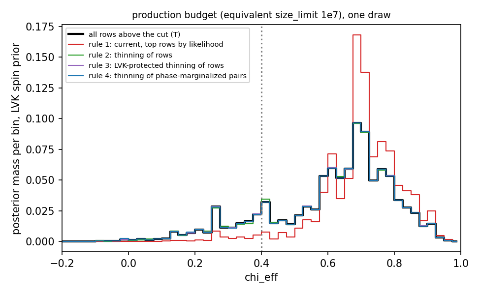
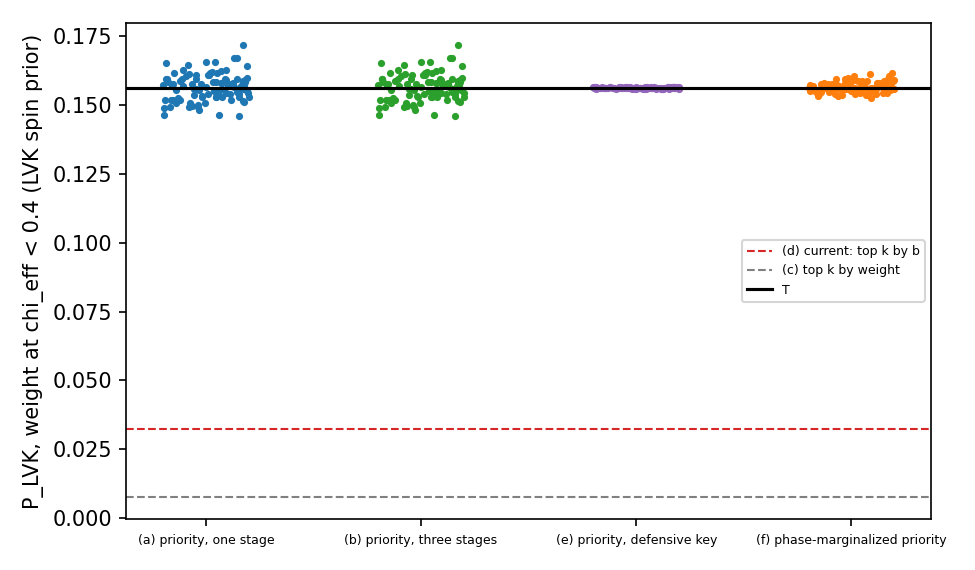

# Thinning dot-PE's rows by weight instead of by likelihood

This report tests rules that keep a reweighted random subset of dot-PE's (intrinsic, extrinsic,
phase) rows, in place of the current rule that keeps the rows of highest distance-maximized
log-likelihood. Each rule is applied offline to a complete set of rows of GW240525_201644 and
judged on whether it reproduces that set's posterior at the row budget production runs face.
The rule chosen among those that pass is the one to implement in dot-PE.

Code and data: dot-PE branch `research` at commit 38f92b4 for the rule jobs (422551 to 422567)
and at commit 7dc1983 for the analysis (`analyze.py` with the 1e-9 floor); the rows are those of the companion measurement of rows
above the cut (E1, `research/rows-above-cut/2026-11-22_measurement.md`), recomputed from
GW240525_201644's production run (o4b-pe-paper `run_2`, dot-PE 2403731). It supersedes no
report.

## Question and answer

The question: at the row budget production runs face (the ratio of kept rows to rows above the
cut in production), does each of the thinning rules (a), (b), (e) and (f) (defined in Setup) pass
the acceptance test, which asks that it reproduce the posterior of all rows above the nominal cut
(the largest b over run_2's kept rows minus 20) without bias and with bounded spread?

The answer: (e), priority sampling on a key that mixes the weights under the IAS prior (dot-PE's
production prior) and the LVK spin prior, and (f), priority sampling of phase-marginalized pairs (one template with one extrinsic sample,
all phases together),
pass; (a) and (b), priority sampling on the IAS-prior weight, fail on one measure, the 5 %
quantile of chirp mass (bias 4.6e-4 of its posterior standard deviation). (e) and (f) pass only
with the 1e-9 floor of the bias test added after the first evaluation (Setup, "Acceptance");
without it they fail on measures where all 100 seeds give the same value, on floating-point
round-off.

## Setup

A *row* is one (intrinsic, extrinsic, phase) combination; b is its distance-maximized
log-likelihood, (d|h)²/(2(h|h)) for (d|h) > 0 (`bestfit_lnlike`, `dot_pe/thin_coherent.py:258`).
The nominal cut is c = 16.379, the largest b over run_2's kept rows minus 20 (E1, Setup).

### Reference table T

T is every row with b ≥ c of E1's 120 sampled i-blocks (groups of up to 512 templates):
91 152 316 rows. Its posterior is the reference.

### Row weight, key and threshold

A row's log weight is ln w = `ln_posterior` − ln N_k, its posterior on the scale common to all
banks (`dot_pe/inference.py:1523`), where N_k, the number of rows bank k could have produced
(n_phi × n_ext × the bank's template count, `per_bank_results`), is equal for run_2's three
banks. With u drawn once per row from a seeded uniform generator on (0, 1], the *key* is

    κ = ln w − ln u.

Keeping the k rows of largest κ (k, the row budget, below), the *threshold* τ is the largest κ
dropped, and a kept row's weight is

    ŵ = max(w, e^τ),

which makes every sum of ŵ over kept rows an unbiased estimate of the sum of w over all rows
(Duffield, Lund & Thorup 2007, J. ACM 54, 32). With several drops, τ is the largest key dropped
at any of the row's stages: its i-block, its bank, and all banks together.

### Rules

- (d) current rule: per i-block keep the top k_blk rows by b (k_blk, the per-block cap, below),
  per bank the top k, over all banks the top k; ŵ = w.
- (c) the same stages, ranked by ln w instead of b; ŵ = w.
- (a) priority sampling, one stage: the k rows of largest κ.
- (b) priority sampling in the three stages of (d), with κ in place of b.
- (e) as (b), with the key built on w_def = (w/S + w_LVK/S_LVK)/2, where w_LVK is w times the
  template's LVK spin-prior ratio (the LVK spin prior over dot-PE's, `lvk_reweight` of
  o4b-pe-paper) and S, S_LVK are the sums of w and w_LVK over T; each posterior is then
  reweighted by w/w_def or w_LVK/w_def.
- (f) as (b), on *pairs* (bank, i, e) (template bank, template index, extrinsic-sample index)
  instead of rows: a pair's weight W is the sum of w over its rows in T, one of its rows is drawn
  with probability w/W and stored, and the kept pair's weight is max(W, e^τ). A kept pair is one
  stored row.

### Budget

k = |T| × 1e7 / N̂(c) = 1 231 583 rows, the production ratio of `size_limit` = 1e7 to the
7.40e8 rows above the cut (E1); E1's 68 % interval, 7.34e8 to 7.47e8, gives k from 1 220 000
to 1 242 000 (1 220 786 to 1 242 368), and the test is run at the central k. k_blk is production's per-block cap,
max(50 000, 2 × 1e7 // B_k) with B_k the bank's number of i-blocks (E1)
(`dot_pe/thin_coherent.py:112`): 64 724 for bank_0 and 50 000 for bank_1 and bank_2. 100 seeds
per randomized rule.

### Measures and acceptance

Per rule and seed, against T's value: the evidence ratio Σŵ/Σw (unitless); the 5 %, 50 % and
95 % quantiles of chi_eff = (m1 s1z + m2 s2z)/(m1 + m2), the mass-weighted aligned spin, of
chirp mass (solar masses) and of q = m2/m1, under the IAS prior;
P_LVK, the posterior weight at chi_eff < 0.4 under the LVK spin prior (`lvk_reweight`, o4b-pe-
paper; the distance part of the LVK prior is not row-level and is left out); n_effective_i and
n_effective_e, the effective numbers of distinct templates and extrinsic samples
(`get_n_effective_total_i_e`).

### Bias and spread

For a measure with values m_s over seeds s = 0 … 99 and value m_T on T,

    bias = mean_s(m_s) − m_T,      spread = standard deviation over s of m_s.

### Acceptance

A rule passes if, for the evidence ratio, the quantiles and P_LVK,

    |bias| ≤ 2 × spread / √100 + 0.1 × spread   (or |bias| ≤ 1e-9 × max(1, |T's value|)),

each spread is below its ceiling (0.05 for the evidence ratio, 0.1 × T's posterior standard
deviation for a quantile, 0.02 for P_LVK), and its mean n_effective_i is not below that of (d).
The 1e-9 floor was added after the first evaluation, in which every randomized rule failed,
all but one failure being identical quantiles in all seeds that differed from T's value by
floating-point round-off (`research/weight-thinning/design.md`, "Design note, 2026-11-22 11:45").

## Results

For seed 0, where in b, the distance-maximized log-likelihood, do the kept rows of each rule
lie, against T, the reference set of all rows with b ≥ c?

The current rule (d) keeps every row of T with b above 24.26 and none below; (a), (b) and (e)
keep all rows near the top and a thinning subset down to c, the nominal cut; (f) keeps one row
per pair, so it has fewer rows at high b. Empty bins are drawn at 0.5.

For seed 0, what posterior of chi_eff, the mass-weighted aligned spin, under the LVK spin prior does each rule give, against T?

The priority rules follow T's posterior, including its tail below chi_eff = 0.4; (d) misses the
tail.

Across seeds, what is P_LVK, the weight at chi_eff < 0.4 under the LVK spin prior, per rule?

T gives 0.156; the 100 seeds of (a) and (b) scatter by 0.005 around it, (f) by 0.002 and (e) by
0.0002; (d) gives 0.032 and (c) 0.008.

What are the bias and spread of every measure per rule? The table gives T's value, the value of
the deterministic rules (d) and (c), and for the randomized rules the mean over seeds with the
spread in parentheses; the bias is the mean minus T's value.

| measure | T | (d) | (c) | (a), (b) mean (spread) | (e) mean (spread) | (f) mean (spread) |
|---|---|---|---|---|---|---|
| evidence ratio | 1 | 0.718 | 0.876 | 1.000 (0.0002) | 1.000 (0.0003) | 1.000 (0.00003) |
| chi_eff 5 % | 0.689 | 0.737 | 0.733 | 0.689 (2e-5) | 0.689 (0) | 0.689 (0) |
| chi_eff 50 % | 0.906 | 0.912 | 0.912 | 0.906 (0) | 0.906 (2e-5) | 0.906 (0) |
| chi_eff 95 % | 0.989 | 0.990 | 0.990 | 0.989 (0) | 0.989 (0) | 0.989 (0) |
| chirp mass 5 % (M☉) | 26.970 | 27.92 | 27.80 | 26.969 (0.003) | 26.970 (0.003) | 26.970 (0.0008) |
| chirp mass 50 % (M☉) | 30.163 | 30.25 | 30.30 | 30.163 (0) | 30.163 (0) | 30.163 (0) |
| chirp mass 95 % (M☉) | 35.263 | 35.26 | 35.26 | 35.263 (0) | 35.263 (0) | 35.263 (0) |
| q 5 % | 0.1124 | 0.1124 | 0.1120 | 0.1124 (0) | 0.1124 (0) | 0.1124 (0) |
| q 50 % | 0.385 | 0.385 | 0.371 | 0.385 (0) | 0.385 (0) | 0.385 (0) |
| q 95 % | 0.893 | 0.879 | 0.880 | 0.893 (0.0004) | 0.893 (0.0006) | 0.893 (0.0002) |
| P_LVK | 0.156 | 0.032 | 0.008 | 0.157 (0.005) | 0.156 (0.0002) | 0.157 (0.002) |
| lowest kept b | 16.379 | 24.26 | 16.38 | 16.380 | 16.379 | 16.379 |
| n_effective_i | 337.1 | 232.3 | 268.2 | 337.1 (0.1) | 337.1 (0.2) | 337.1 (0.02) |
| n_effective_e | 393.4 | 292.2 | 319.0 | 393.4 (0.2) | 393.4 (0.2) | 393.5 (0.02) |

A spread written 0 is below 1e-12. (a) and (b) give identical results: no block or bank cap
removed a row under their keys. Their one failing measure is the 5 % quantile of chirp mass,
bias −0.0010 M☉, 3.1 standard errors of the mean over seeds and 4.6e-4 of T's posterior standard
deviation of chirp mass. (e) and (f) pass every measure. Rule (f) goes to the implementation
by the user's instruction to combine phase marginalization with thinning; (e) has the smaller
spread of P_LVK (0.0002 against 0.002).

## Limitations

- One event, and 120 of its 1162 i-blocks; the rules are tested against T, not against cogwheel.
- Rows below c are absent from T; for (f) a pair's weight is the sum over its phases in T, not
  over all 100 phases.
- Quantiles and P_LVK are ratio estimators, unbiased only to order 1/n_effective; the
  evidence ratio is exactly unbiased.
- n_effective computed from the thinned weights ŵ is not an estimate of T's n_effective in
  general (raising weights to e^τ, the threshold, makes them more even); here the two agree to
  0.1.
- The acceptance of (e) and (f) depends on the 1e-9 floor set after the first evaluation (Setup,
  "Acceptance").

## Reproduction

    python research/lsf_submit.py --name e3_rule_<r> --env o4a-pe --mem-mb 48000 -- \
        research/weight-thinning/thin.py --rule <r> --seeds 100      # r in d, c, a, b, e, f
    python research/weight-thinning/analyze.py                       # env o4a-pe

Output: `artifacts/research/weight-thinning/` (`<rule>.csv`, `reference.json`, `measures.csv`,
`verdict.json`) and `research/weight-thinning/review/`. Each rule took 88 to 587 s on one core
and up to 16.4 GB.

Line numbers in citations of `dot_pe/` refer to commit 38f92b4 (before `row_thinning` was added).
